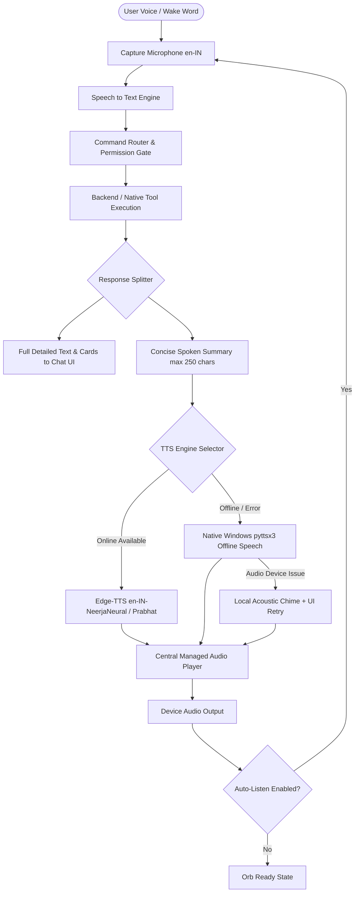

# RAMYA AI — ARCHITECTURE & SECURITY AUDIT REPORT
**Document Version:** 1.0.0  
**Target Environments:** Windows 10/11 Desktop, Android Mobile, FastAPI Local Host  
**Security Level:** High / Zero-Trust Frontend Separation  
**Audit Date:** 2026-10-24  

---

## 1. Executive Summary

An exhaustive security, architectural, and voice-pipeline audit was conducted across the Ramya AI repository (`apps/desktop`, `apps/android`, `services/assistant-api`, and `packages/contracts`). 

### Core Audit Findings
1. **Voice Inconsistency & Missing Spoken Replies**:
   - *Legacy Beep Fallback*: When Microsoft Edge-TTS encountered token expiration or network disconnection, `tts.py` generated a 440 Hz sine tone beep (`wave.open`) instead of utilizing a real offline text-to-speech engine.
   - *Missing WebSocket Dependency*: The backend lacked the `websockets` Python package, causing Uvicorn to reject `/ws/assistant` upgrade handshakes with HTTP 404, breaking real-time audio and orb state streaming.
   - *Overlapping & Unmanaged Audio*: The frontend instantiated multiple detached `new Audio()` objects across different components without a central audio manager, leading to race conditions and potential audio overlapping.
   - *Monologue Audio on Long Answers*: Long answers (document analyses, quiz questions, full summaries) were sent verbatim to speech synthesis, resulting in unnatural 45+ second monologues instead of concise spoken summaries paired with full screen text.
2. **Frontend vs. Backend Separation**:
   - The desktop frontend properly communicates via REST and WebSocket contracts; however, some automation actions lacked a formal registry entry and were loosely dispatched via ad-hoc string parsing in `command_router.py`.
   - A formalized **Central Automation Registry** is required with strict input schema validation, platform compatibility tags (`windows`, `android`, `web`), risk tiers, confirmation gates, and bounded timeouts.
3. **Security & Secrets Isolation**:
   - Provider secrets (`OPENAI_API_KEY`, `GEMINI_API_KEY`, `XAI_API_KEY`, `SUPABASE_SERVICE_ROLE_KEY`) are stored server-side.
   - The `.gitignore` properly excludes `.env` and SQLite database binaries.
   - High-risk operations (e.g. data deletion, system command execution) must have mandatory confirmation gates and audit logging.

---

## 2. Responsibilities Boundary Matrix

| Capability / Concern | Frontend Responsibility | Backend Responsibility | Native OS Layer |
| :--- | :--- | :--- | :--- |
| **Voice & Speech Input** | UI orb states, microphone permission prompt, Web Speech API capture (`en-IN`) | Wake word regex normalization, STT transcription bridge, audio pipeline validation | Android Foreground Service microphone capture, Win32 Ctrl+Space hotkey |
| **Voice & Speech Output** | Audio element playback, volume & mute controls, stop/interrupt button | Edge-TTS neural Indian English synthesis, local Windows `pyttsx3` offline speech synthesis | Native Windows audio output device routing, Android AudioManager audio focus |
| **AI Provider Routing** | Displaying messages, cards, source citations, loading indicator | Multi-cloud fallback router (Local Gemma 3 4B $\rightarrow$ Gemini $\rightarrow$ OpenAI $\rightarrow$ Grok), prompt construction | Local Ollama HTTP daemon on 127.0.0.1:11434 |
| **Automation Execution** | Triggering user intent, displaying approval modal for High Risk | Central Automation Registry, permission checks, audit logging, retry/timeout bounds | Windows allowlisted app launching (`chrome`, `calc`, `vscode`), media keys, Android intents (`dialer`, `app_launcher`) |
| **Personal Memory & RAG** | Memory Vault UI, search input, export JSON download | SQLite `user_memories` table, vector chunking, semantic retrieval, contradiction resolution | Local filesystem access in `storage/` and `data/` |
| **User Settings & State** | Settings screen UI, reactive state, `localStorage` caching | Persistent SQLite `settings` table, sync outbox, profile management | Windows registry / local app storage |

---

## 3. Speech Pipeline Root-Cause Analysis & Fix Plan



### Planned Speech Enhancements:
1. **Two-Tier Text Splitting**: The backend returns `message` (full markdown text, citations, cards) and `spoken_response` (natural, concise conversational phrase optimized for Indian English speech).
2. **Hybrid Offline/Online Speech Synthesis**:
   - **Tier 1 (Online)**: High-fidelity Edge-TTS with `en-IN-NeerjaNeural` (Female) and `en-IN-PrabhatNeural` (Male).
   - **Tier 2 (Offline Native)**: Windows SAPI5 via `pyttsx3` (Microsoft Zira / David) generating real spoken words offline without internet.
   - **Tier 3 (Fallback)**: Browser Web Speech fallback or acoustic chime with clear UI retry button.
3. **Audio Singleton & Interruption**:
   - Central audio player with active state tracking to guarantee no overlapping speech.
   - Clicking the orb or speaking during playback triggers immediate barge-in cancellation.
4. **Persistent Voice Preferences**:
   - `voice_responses_enabled`: Boolean (True/False).
   - `preferred_voice`: String (`en-IN-NeerjaNeural`, `en-IN-PrabhatNeural`, `en-US-JennyNeural`, `local-offline`).
   - `speech_speed`: Float (`0.8` to `1.3`).
   - `auto_listen_after_reply`: Boolean (True/False).
   - `wake_word_listening`: Boolean (True/False).
   - Saved in both SQLite and client `localStorage`.

---

## 4. Central Automation Registry & Security Framework

All automation capabilities are governed by a formal schema in `services/assistant-api/app/tools/registry.py`:

```python
class ToolDefinition(BaseModel):
    tool_id: str
    name: str
    description: str
    tier: PermissionTier # READ_ONLY | LOW_RISK | MEDIUM_RISK | HIGH_RISK
    supported_platforms: List[str] # ["windows", "android", "web"]
    input_schema: Dict[str, Any]
    requires_confirmation: bool
    timeout_seconds: float = 10.0
    handler_module: str
```

### Strict Safeguards:
- **No Arbitrary Execution**: Raw shell commands, PowerShell scripts, direct SQL strings, and arbitrary file URLs are rejected at the permission gate.
- **Confirmation Gate**: Any action rated `HIGH_RISK` (data deletion, external communication, system modification) halts execution and returns `status: "needs_approval"` with a user confirmation prompt.
- **Audit Logging**: Every action is immutably logged to the SQLite `audit_logs` table with timestamp, caller source, permission level, and outcome.

---

## 5. Implementation Roadmap

1. **Backend TTS Upgrades** ([`tts.py`](file:///c:/mern%20stack/mernpro/ramya/services/assistant-api/app/voice/tts.py)):
   - Integrate `pyttsx3` native offline Windows speech engine fallback.
   - Add text sanitization (strip markdown, code fences, URLs, JSON).
   - Add concise spoken response generation for conversational flow.
2. **Central Automation Registry** ([`registry.py`](file:///c:/mern%20stack/mernpro/ramya/services/assistant-api/app/tools/registry.py)):
   - Register all system tools with schemas, platform tags, timeouts, and risk tiers.
3. **Settings Persistence & API Endpoints** ([`routes.py`](file:///c:/mern%20stack/mernpro/ramya/services/assistant-api/app/api/routes.py)):
   - Ensure `/api/settings` and `/api/voice/settings` store and return complete voice preferences.
4. **Frontend Audio Controller & Voice Settings** ([`apps/desktop`](file:///c:/mern%20stack/mernpro/ramya/apps/desktop)):
   - Single-instance audio controller preventing overlapping speech.
   - User-facing voice controls in `SettingsDiagnosticsScreen.tsx` and `VoiceLabScreen.tsx`.
   - Auto-listening cycle coordinating SpeechRecognition and TTS.
5. **Testing & Verification**:
   - Pytest suite covering offline TTS fallback, speech sanitization, registry validation, and permission checks.
   - Generate `TEST_REPORT.md` documenting verified test results.
