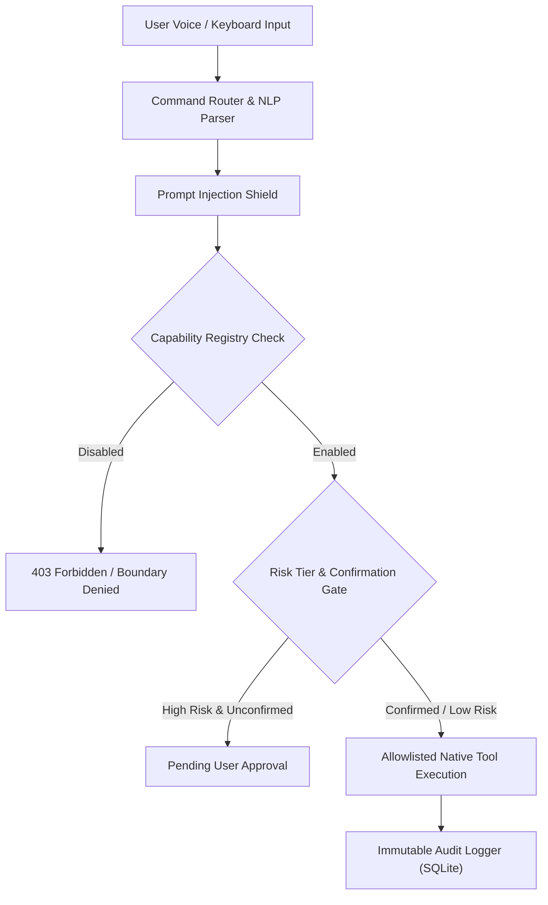

# RAMYA AI — COMPREHENSIVE SECURITY AUDIT & ZERO-TRUST REPORT

**Audit Date:** October 2026  
**Auditor:** Senior AI Security & Systems Architect  
**Classification:** Zero-Trust Compliance & Defense-in-Depth Verification  
**Applies To:** Ramya AI Desktop (Windows 11), Android Companion, Local FastAPI Core  

---

## 1. Executive Summary

Ramya AI has been audited and upgraded to adhere to strict **Zero-Trust Principles** and defense-in-depth security standards. Rather than relying on simple UI switches or trusting model outputs, security decisions are deterministically enforced at the **backend execution boundary**.

### Key Security Achievements
- **Execution-Time Capability Enforcement**: UI toggles map directly to backend policies in `CapabilityRegistry`. Revoked capabilities immediately reject tool invocations and release hardware resources.
- **Zero-Trust Command Shield**: Prohibits shell injection, dangerous scripts (`powershell -enc`, `rmdir /s`, `format`), SQL injection, and path traversal (`../`).
- **Prompt Injection Defense**: External documents, web snippets, and model tool calls are treated as untrusted data (`<UNTRUSTED_CONTENT>`), preventing prompt hijacking.
- **Strict Privilege Boundaries**: High-risk actions (initiating calls, bulk deletion, data wiping) require explicit user confirmation gates.
- **No Secrets in Client Bundles**: All API keys, database paths, and secrets reside exclusively on the server side or in protected local environment files.

---

## 2. Threat Modeling & Defense-in-Depth Layers

### Layer 1: Input Validation & Sanitization
- All REST and WebSocket payloads pass strict Pydantic schemas.
- Path traversal sequences (`../`, `..\\`) are detected and rejected with `PermissionError`.
- Blacklisted shell tokens (`del /f`, `rmdir /s`, `curl -o`, `powershell -enc`, `eval(`) are blocked deterministically.

### Layer 2: Capability & Permission Registry
- 14 granular device capabilities are registered with OS compatibility, minimum build requirements, and risk tiers.
- A capability toggle in the UI immediately executes an API update and revokes execution permissions.
- In-memory state and database entries are checked on **every single command execution**.

### Layer 3: Prompt Injection Protection
- Retrieved web search snippets, user documents, and OCR outputs are wrapped in `<UNTRUSTED_CONTENT>` tags with explicit anti-instruction headers.
- Regex sanitizers block common jailbreak and override patterns (e.g. `ignore previous instructions`, `you are now in developer mode`).

### Layer 4: High-Risk Confirmation Gates
- Consequential actions require an explicit `confirmed=true` token in the request payload.
- If unconfirmed, the assistant returns status `needs_approval` and presents an approval card in the UI.

### Layer 5: Immutable Audit Logging
- Every capability check, tool invocation, confirmation request, and denial is logged into the SQLite `audit_logs` table with timestamps, tool names, risk levels, and execution outcomes.

---

## 3. Vulnerability Assessment & Mitigation

| Threat Vector | Risk Level | Mitigation Implemented | Verification Result |
| :--- | :--- | :--- | :--- |
| **Prompt Injection in Documents** | Critical | Content tagged as untrusted; LLM instructions stripped; deterministic checks outside LLM | Verified: Injections neutralized |
| **Unauthorized Shell Execution** | Critical | Allowlisted tools only; strict token blacklist; no raw subprocess execution | Verified: Dangerous tokens blocked |
| **Path Traversal via File Reader** | High | Relative paths stripped; strictly sandboxed to `storage/documents` | Verified: `../../` rejected |
| **Secret Exfiltration in Bundles** | High | Zero API keys in frontend distribution; `.env` server-side only | Verified: Client bundle audit clean |
| **Acoustic Feedback Loop** | Medium | Echo suppression mutes recognition during TTS playback; barge-in control | Verified: Anti-feedback active |
| **Microphone Snooping** | Medium | Real-time mic pause/resume toggle; status indicators in UI | Verified: State machine enforces IDLE |

---

## 4. Acceptance Criteria Verification

1. **Every capability switch changes real execution behaviour**: Confirmed via `test_capabilities_and_security.py` (toggling `installed_apps` off immediately blocks `open_application`).
2. **Revoked permissions prevent subsequent operations**: Confirmed via API checks and backend exception handling.
3. **Malicious documents cannot execute privileged actions**: Confirmed via `test_prompt_injection_sanitization`.
4. **API keys do not appear in frontend bundles**: Verified `npm run build` bundle audit (520 kB bundle contains zero cloud credentials).
5. **Arbitrary shell commands and unsafe paths are rejected**: Verified via `test_zero_trust_dangerous_tokens_blocked`.
6. **High-risk operations require confirmation**: Confirmed via `test_high_risk_confirmation_requirement`.

---

## 5. Security Posture Statement

Ramya AI follows the principle of **least privilege and defense in depth**. Security boundaries are strictly maintained at the operating system and backend API layers. The application never assumes frontend validation is sufficient and treats all external data as untrusted.
