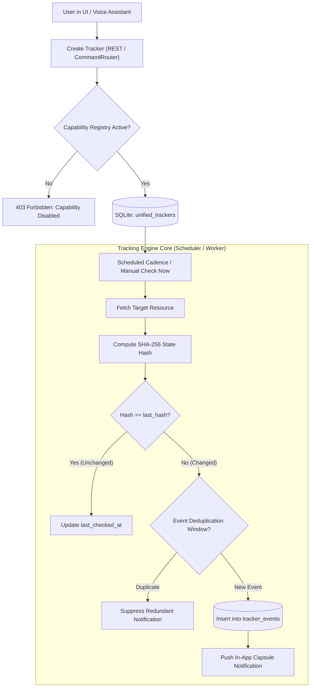

# RAMYA AI — AUTONOMOUS TRACKING & MONITORING SPECIFICATION

**Document Version:** 1.0.0  
**Target Environments:** Windows 11 Desktop, Android Foreground Service, Local FastAPI Engine  
**Compliance:** Zero-Trust Observability & Non-Covert Monitoring  

---

## 1. Executive Summary

Ramya AI's **Tracking & Monitoring Subsystem** enables user-approved, autonomous tracking across productivity workflows, local filesystem directories, hardware health, and external API endpoints.

### Core Tracking Principles
1. **Zero Covert Monitoring**: Trackers exist solely upon explicit user creation or authorization. The application never secretly logs user behavior, external apps, or device location.
2. **State-Change Hashing**: Checks calculate a deterministic SHA-256 hash of the target state. Notifications are emitted **only** when a meaningful state change occurs, preventing notification fatigue.
3. **Execution-Time Gate**: If a tracker's prerequisite capability (e.g. `file_system`, `location_awareness`) is revoked, the tracker immediately suspends execution.
4. **Resilient Local Persistence**: Tracker definitions, execution cadence, hashes, and historical events are maintained locally in SQLite (`unified_trackers` and `tracker_events`).

---

## 2. Tracking Engine Architecture



---

## 3. Supported Tracker Types & Adaptors

| Tracker Type | Purpose & Scope | Target Configuration | Change Detection Mechanism | Interval Cadence |
| :--- | :--- | :--- | :--- | :--- |
| **`task`** | Productivity deadlines, high-priority tasks, and overdue items | `status=pending`, due dates in SQLite | Task status transition or overdue threshold crossing | 300s (5 mins) default |
| **`health`** | Hardware metrics: CPU %, Memory %, Disk utilization | Windows Performance Counters / OS Metrics | Exceeding 90% threshold or >15% swing from previous reading | 60s default |
| **`file`** | Critical directory and file change monitoring | Absolute path in `storage/documents` | Recursive file size and SHA-256 content checksum | 120s default |
| **`service`** | Cloud API or local microservice endpoint availability | HTTP URL (e.g. `http://127.0.0.1:8000/api/health`) | HTTP status code deviation (e.g. 200 -> 500) or latency spike | 180s default |
| **`location`** *(Restricted)* | User-explicit geographical context (e.g. weather alerts) | Authorized coordinates / city | Explicit location change with visible OS status bar indicator | On-Demand only |

---

## 4. State Change Detection & Anti-Fatigue Hashing

To guarantee users are not bombarded with spam notifications, the `TrackingEngine` uses a two-tier deduplication filter:

```python
# State Hash Computation
state_payload = json.dumps(current_state, sort_keys=True)
current_hash = hashlib.sha256(state_payload.encode()).hexdigest()

if current_hash != tracker.last_hash:
    # Meaningful state delta detected!
    tracker.last_hash = current_hash
    emit_tracker_event(tracker_id, event_type="state_change", message=summary)
else:
    # State identical; touch timestamp only
    update_last_checked(tracker_id)
```

### Notification Deduplication:
- Events within a 15-minute sliding window with identical event titles are automatically coalesced.
- Each event includes an unread status (`is_read=0`) allowing users to acknowledge or dismiss alerts.

---

## 5. Location & Device Privacy Safeguards

1. **Clear UI Indicator**: Whenever a location-aware feature runs, the UI displays an active location badge.
2. **OS Permission Alignment**: Requires explicit `ACCESS_FINE_LOCATION` on Android and Windows Location service activation.
3. **No Background Exfiltration**: Location coordinates are processed exclusively on-device for local context (e.g., local weather, sunset time) and never transmitted to external analytics providers.
4. **Hard Kill Switch**: Disabling `location_awareness` in the **Security & Permissions** screen immediately terminates any location-dependent trackers.

---

## 6. API Endpoints Reference

| Method | Endpoint | Description | Execution-Time Security Check |
| :--- | :--- | :--- | :--- |
| `GET` | `/api/tracking` | List all active trackers & recent events | Authenticated user session |
| `POST` | `/api/tracking` | Create new tracker with custom interval | Validates target path / URL schema |
| `POST` | `/api/tracking/{id}/toggle` | Pause or Resume tracker execution | Updates `is_active` state |
| `POST` | `/api/tracking/{id}/check` | Trigger immediate on-demand check | Enforces rate limit (max 1/10s per tracker) |
| `DELETE` | `/api/tracking/{id}` | Permanently delete tracker & associated events | Row-level ownership check |
| `POST` | `/api/tracking/events/{id}/read` | Mark event notification as read | Row-level ownership check |
